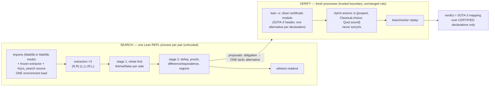

# SOTA-4: one-process certified CJCS engine — report

Caleb J. Westfall · ProofScope · research branch `research/sota4-oneprocess` (from `379151101d81bdc0ac48064f2cf76fdb7612e0e6`)

> **Release status: INCONCLUSIVE** (see I). Soundness was preserved in every test that was run. The central
> performance target is defined on the 24-pair *Mathlib* development suite. Mathlib cannot be reached from
> the development sandbox, so that target has not been measured yet. The workflow that measures it is part
> of this change. Nothing in this report is a benchmark, an independent evaluation or a state-of-the-art claim.

## A. Architecture

**Trusted:** the Lean 4.34.1 kernel and `leanchecker`, the Lean elaborator in the *verification* process, the
axiom rule from `proofscope/certify.py` (unchanged, frozen), and the 20-line verdict mapping (copied
unchanged from SOTA-3). **Untrusted:** the REPL, the search metaprogram (`lean/ProofScope/CJCSSearch.lean`),
the extractor, the obligation generator. If the search lies, a proposal fails verification, the module does
not compile and the pair becomes `VERIFY_REJECTED` (fail closed; tested by forging search results).

What the search reproduces exactly: each obligation is the SOTA-3 declaration
`theorem k : S := by first | ((t₀); done) | …` under the same 200000-heartbeat budget, with a marker
`trace "CJCS_ALT i"` after each alternative. `first` keeps only the winning branch's messages, so the
surviving marker names the alternative SOTA-3 would have used. The certificate contains only that
alternative.

Redundant work removed per pair:
* environment loads for search: from 5 Lean runs (extract, stage-1 probe, certify probe, certify compile,
  witness readout) plus `leanchecker`, down to 1 REPL load, 1 verification compile and `leanchecker`;
* stage-1 obligations re-elaborated in stage 2;
* the certify probe;
* giant `first` blocks in the certificate;
* the separate witness-readout process.

**No cache.** A cache would make per-pair CPU incomparable with SOTA-3 and the competitors, and a cached
verdict is not a certificate.

## B. Source changes (all on the research branch; frozen branches untouched)
| file | what |
|---|---|
| `proofscope/experimental/cjcs4.py` | one-process engine (REPL client, search, independent verification, unchanged verdict mapping) |
| `lean/ProofScope/CJCSSearch.lean` | `#cjcs_search` command (untrusted proposer) |
| `bench/runner.py` | adds system `cjcs4` (same adapter, budget and outcome mapping as `cjcs`); nothing else |
| `bench/sota4/` | `integrity` (canonical-JSON manifests), `measure` (case-level A/B measurement with process-launch shims), `specs`, `failures`, `report` |
| `bench/pilot/` | blinded two-reviewer labelling, agreement, adjudication (no labels) |
| `research/cjcs/*.MANIFEST.json` | held-out and dev manifests computed from the authenticated original bytes |
| `research/cjcs/sota4_hostile/` | 12 hostile pairs with explicit expected / must-not results |
| `tests/sota4/` | integrity (15), engine adversarial (11), pilot (7) |
| `.github/workflows/sota4-research.yml` | the SOTA-4 workflow (artifacts `sota4-integrity`, `-theory`, `-core-heldout`, `-soundness`, `-performance`, `-development-*`, `-summary`) |
| `docs/sota4/` | this report, `INTEGRITY.md`, `SOUNDNESS_AUDIT.md`, `MATH_LIMITS.md`, `PILOT_PROTOCOL.md`, `FAILURES.md`, `SOTA3_FREEZE.txt`, `evidence-local/` |

**Build:**
1. Lean 4.34.1.
2. `git clone https://github.com/leanprover-community/repl`, then check out `193cf4bb9a22bb3fc6d25774f0fe6a70db1fd6ee`.
3. Set `lean-toolchain` to `v4.34.1`, run `lake build repl`, and point `PROOFSCOPE_REPL` at `.lake/build/bin/repl`.
4. Run `python -m proofscope.experimental.cjcs4 run <spec.json>… --out DIR`.

For Mathlib mode, also set `PROOFSCOPE_IMPORTS=Mathlib` and put Mathlib `d13f23b` on `LEAN_PATH`.

## C. SOTA-3 integrity investigation
Full evidence is in `INTEGRITY.md`.

**Root cause: newline normalization in transit.**
- Every one of the 24 CJCS JSON files gained exactly one trailing `0x0A` when the patch was applied. No other byte changed anywhere in the tree.
- With that byte removed, the files reproduce the recorded `bb8628b6…` exactly. The checkout as committed hashes to `8cc0460c…`.

**The held-out set is authenticated and kept unchanged.** It was written by the developer, so it counts as regression evidence only.

**Repair.** The raw-byte gate is replaced by a manifest of canonical-JSON digests. That manifest was computed from the authenticated bytes, not from the checkout. A byte-level reconstruction of `bb8628b6…` stays available as `--require-legacy`. There are 15 property tests.

## D. CJCS verification (Task C)
These were run locally in the sandbox with core Lean, which is all the core suites need. The workflow repeats them on GitHub.
- **Theory.** `CJCS.lean` compiles. It has 9 axiom-free declarations, 5 that use propext, Classical.choice and Quot.sound, and 1 that uses propext and Quot.sound. No declaration uses `sorryAx`. `leanchecker --fresh CJCS` exits with code 0.
- **Held-out core suite, unchanged SOTA-3 engine (14 pairs).** 11 of 14 are exact and there are 0 must-not violations. The 3 misses are ABSTAIN:
  - h01 (expected equivalence): the reference is not provable by the portfolio;
  - h04 and h12 (expected difference): no one-sided proof and refutation were found.

  Every certificate passed the axiom audit and replay. This matches SOTA-3's first-run claim.
- **SOTA-4 engine on the same pairs.** Verdicts are identical on 24 of 24 (core_dev plus held-out). Every SOTA-3 certificate is also certified by SOTA-4. On h01, h04 and h12, SOTA-4 certifies valid partial results that SOTA-3 lost to finding F3.

The case-level verdicts are in `evidence-local/core_verdicts.md`.

## E. Performance (case level)
**Variant A** has the benchmark shape: every case builds the extractor and is charged for it.

**Variant B** prebuilds the engine's own modules once for both engines and does not charge that build to any case.

The table shows whole-process-tree CPU-s per case in core Lean, measured with Lean launches counted by a PATH shim.

| case | verdict (identical for both engines) | A: SOTA-3 | A: SOTA-4 | B: SOTA-3 | B: SOTA-4 | Lean launches A (S3→S4) | peak RSS MB A (S3/S4) |
|---|---|---|---|---|---|---|---|
| c01_natsub_needs_hyp | DIFFERENCE reference_false_formalization_true | 5.05 | 4.44 | 3.78 | 2.93 | 7→4 | 1618/1686 |
| c02_natabs_analogue | DIFFERENCE reference_false_formalization_true | 4.58 | 4.42 | 3.56 | 3.04 | 7→4 | 1616/1689 |
| c03_identical_true | EQUIVALENCE definitional | 4.97 | 5.76 | 3.73 | 4.08 | 6→4 | 1618/1724 |
| c04_both_false | EQUIVALENCE both_false | 4.92 | 4.99 | 4.54 | 2.94 | 7→4 | 1608/1702 |
| c05_quantifier_swap | DIFFERENCE reference_true_formalization_false | 5.22 | 4.73 | 3.61 | 3.24 | 7→4 | 1619/1717 |
| c06_strengthened_conclusion | DIFFERENCE reference_true_formalization_false | 5.69 | 5.68 | 4.87 | 3.43 | 7→4 | 1606/1711 |
| c07_vacuous_both_true | EQUIVALENCE both_true | 4.49 | 5.63 | 3.25 | 3.45 | 6→4 | 1619/1714 |
| c08_joint_drift | DIFFERENCE reference_true_formalization_false | 9.31 | 8.17 | 8.44 | 5.14 | 7→4 | 1616/1740 |
| c09_bool_dropped | DIFFERENCE reference_true_formalization_false | 5.29 | 5.01 | 4.19 | 3.01 | 7→4 | 1618/1698 |
| c10_list_open | EQUIVALENCE both_true | 3.48 | 4.47 | 2.06 | 2.65 | 6→4 | 1618/1696 |
| h01_int_abs_sq | ABSTAIN  | 7.29 | 8.73 | 5.35 | 7.15 | 5→4 | 1614/1815 |
| h02_nat_div_mul | DIFFERENCE reference_false_formalization_true | 5.74 | 4.98 | 3.89 | 3.14 | 7→4 | 1614/1703 |
| h03_bool_and_comm | EQUIVALENCE both_true | 4.22 | 5.04 | 3.49 | 2.85 | 6→4 | 1614/1705 |
| h04_list_length_append | ABSTAIN  | 4.63 | 7.90 | 3.27 | 5.36 | 5→4 | 1618/1807 |
| h05_exists_bound_swap | DIFFERENCE reference_true_formalization_false | 5.36 | 4.84 | 3.79 | 2.96 | 7→4 | 1619/1705 |
| h06_off_by_one | DIFFERENCE reference_true_formalization_false | 6.58 | 6.14 | 6.60 | 4.11 | 7→4 | 1606/1704 |
| h07_vacuous_ref | DIFFERENCE reference_true_formalization_false | 5.09 | 5.12 | 4.33 | 2.89 | 7→4 | 1619/1705 |
| h08_both_false_different | EQUIVALENCE both_false | 5.34 | 4.72 | 4.47 | 3.44 | 7→4 | 1606/1712 |
| h09_int_sub_order | DIFFERENCE reference_false_formalization_true | 7.06 | 5.49 | 5.55 | 4.01 | 7→4 | 1619/1736 |
| h10_joint_harmless_parts | DIFFERENCE reference_true_formalization_false | 9.63 | 6.38 | 8.35 | 5.35 | 7→4 | 1616/1700 |
| h11_disjoint_regions | EQUIVALENCE both_true | 8.02 | 6.80 | 5.69 | 5.13 | 6→4 | 1618/1727 |
| h12_open_problem_like | ABSTAIN  | 5.64 | 7.39 | 3.75 | 5.83 | 5→4 | 1616/1893 |
| h13_identical_unprovable_here | EQUIVALENCE definitional | 4.03 | 3.90 | 2.02 | 2.58 | 6→4 | 1618/1706 |
| h14_mixed_strict | DIFFERENCE reference_true_formalization_false | 7.42 | 7.85 | 6.27 | 6.94 | 7→4 | 1619/1859 |
| **median** | | **5.32** | **5.31** | **4.04** | **3.43** | 7.0→4.0 | |

**What this shows (core Lean only):**
- Verdicts are identical on every case, and SOTA-4's certificate sets contain SOTA-3's.
- In variant A the median CPU is unchanged: 5.31 vs 5.32. SOTA-4 is slower on 10 of 24 pairs, by up to 1.70×. That includes the three F3 pairs, where it now compiles and replays more certificates.
- In variant B the median falls from 4.04 to 3.43 (about −15%), but SOTA-4 is still slower on 8 of 24 pairs.
- Peak memory rises from about 1.6 GB to about 1.9 GB, because the REPL keeps the environment and the search declarations live.

Core Lean loads its environment in about 0.3 s, so removing loads barely helps here. The bottleneck the mission targets is the cost of loading Mathlib, about 3.7 CPU-s per load (SOTA-3 diagnosis). SOTA-3 pays that 5 times plus `leanchecker`; SOTA-4 pays it once plus the 2 mandatory verification loads.

**Task G (≤ 10 CPU-s median on the Mathlib suite) is NOT MEASURED.** The analytical floor is 3 environment loads of about 3.7 s each, which is about 11 CPU-s before any search. **The 10-second target is therefore very likely unattainable while external replay is mandatory.** The workflow will report the measured minimum, and that is what must be reported, not this estimate.

Two earlier SOTA-4 builds were slower than SOTA-3. They are kept in `evidence-local/superseded/`.

## F. Soundness audit
See `SOUNDNESS_AUDIT.md`. No unjustified jump from a theorem to a decisive verdict was found. Every decisive verdict is a certified declaration whose statement is the verdict.

These are the weaker points, all reported and none hidden:
- **J1:** drift regions are not linked to R and L.
- **J2:** the "native" outcome NONEQUIV for abstentions.
- **J3:** auto-bound implicits.
- **J4:** Track B mapping depends on an interpretation policy.

**Engine changes that close gaps:**
- **F3** (SOTA-3 kept dependents of failed obligations): handled by explicit dependencies and exact state restore.
- **F2** (point-pool leak between cases): pools are restored per case.

**Hostile controls.** 12 pairs plus 11 adversarial tests. Each one states its expected result. They cover:
- an unverifiable proposal, `sorry`, and `native_decide` (`Lean.ofReduceBool`);
- a difference without its dependency;
- forged search results;
- search timeout with orphan cleanup, and search-process crash;
- point-pool isolation;
- wrong witness domain, a dropped dependent binder, and shared-operator order;
- a missing instance, vacuous pairs, a witness outside the pool, quantifier exchange, and both-true and both-false pairs.

All pass on both engines with 0 must-not violations. One hostile pair is a genuine miss: x10, which needs a nonlinear proof of the reference, abstains for both engines. All hostile cases were written by the engine developer and have not been independently reviewed.

## G. Failure analysis (the 16 SOTA-3 development failures)
**Not completed here.** The SOTA-3 run's records are GitHub artifacts, and this session had no GitHub API or artifact access. Rather than infer causes, the workflow's `summary` job does two things:
- It downloads the original `sota3-runs-cjcs-*` artifacts read-only and classifies every non-evaluated record with `bench.sota4.failures`. The original record and its original class are copied verbatim, and a cause and the last pipeline stage reached are added beside them.
- It runs the same classification on fresh SOTA-3 and SOTA-4 runs under the unchanged tier-20 policy.

`FAILURES.md` gives the cause classes. The working hypothesis from the earlier diagnosis is CPU-budget exhaustion. CJCS used about 48 CPU-s against a 20 s tier plus the startup allowance. That remains a hypothesis until the job reports it.

## H. Independent benchmark preparation
See `PILOT_PROTOCOL.md`, `bench/pilot/` and `tests/sota4/test_pilot.py`. They define:
- a 50-pair composition with provenance requirements;
- sealing through the existing custodian tools;
- blind reviewer packets;
- Cohen's κ and an adjudication queue;
- conflict-of-interest refusal;
- a rule that Track B is never inferred from Track A.

**No case has been selected and no label written.**

## I. Release status: **INCONCLUSIVE**
| gate | status |
|---|---|
| 1 checksum diagnosed, held-out unchanged | **met** (local; CI job `integrity` re-checks) |
| 2 theory declarations verified, axioms acceptable | **met** locally; CI `theory` |
| 3 every decisive verdict linked and replayed | **met** on 24 core + 12 hostile pairs; Mathlib suite pending CI |
| 4 fewer redundant environment loads | **met**: 7 → 4 Lean launches per pair (A), 6 → 3 (B); 1 search load |
| 5 fair performance measurement | core: done (A and B); **Mathlib suite: pending** (`mathlib-measure`) |
| 6 reliability improves without reclassifying failures | partially evidenced (F3 fixed); Mathlib infra-failure counts pending |
| 7 frozen v1.2 and SOTA-3 unchanged | **met** (`V12_FREEZE.txt`, `SOTA3_FREEZE.txt`, dataset diff empty) |
| 8 public case-level evidence | local evidence committed; CI artifacts pending |
| 9 no SOTA or novelty claims | **met** |
| 10 honest classification | INCONCLUSIVE until the Mathlib measurement exists; if it shows median > 10 s with soundness intact, the result becomes **PARTIAL** |

## J. Research assessment
* **Grant application:** modestly more credible.
  - The held-out integrity question now has a forensic answer.
  - The soundness audit found no unjustified verdict mapping, and it names the real gaps (J1–J4).
  - An adversarial test suite and a reviewer pipeline exist.

  It does not add independent evidence. Reviewers will still ask for the 200-pair sealed run.
* **Systems paper:** not yet.
  - The architecture is a standard propose-and-verify split built on an established REPL.
  - The interesting engineering result is the exact reproduction of `first` alternative selection through success markers, with external verification of one alternative.

  A paper needs the Mathlib measurements and an independently labelled evaluation.
* **Mathematical theory paper:** no change. SOTA-4 adds no new mathematics. The open problems in `MATH_LIMITS.md` are where a theory contribution would have to come from, for example a certified joint-telescope link (J1) and regions over dependent telescopes.

Engineering performance is not new mathematics, and kernel compilation is not paper-to-Lean fidelity.
